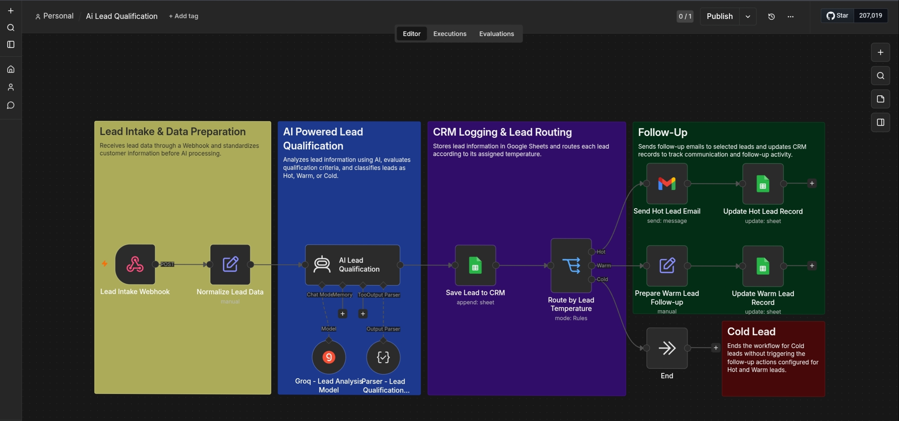

AI Lead Qualification

  <strong>AI-powered lead analysis and qualification using n8n</strong>

---

Overview

This project demonstrates an automated lead qualification workflow built with n8n. It captures lead information, processes submitted data, and uses AI to classify prospects based on their potential priority.

The goal is to help businesses organize incoming leads, reduce manual work, and make follow-up processes more efficient.

Workflow

  

Process:

1. Lead Capture — Receives lead information through a form and webhook.
2. Data Processing — Organizes and prepares the submitted information.
3. AI Classification — Analyzes lead details and assigns a qualification category.
4. Lead Organization — Stores lead information and classification in Google Sheets.
5. Follow-Up Preparation — Makes it easier to identify which leads require attention.

Key Features

- Automated lead capture
- AI-assisted lead qualification
- Lead categorization by priority
- Google Sheets integration
- Structured lead data management
- Reduced repetitive manual tasks

Technologies Used

- n8n
- Webhooks
- APIs
- JSON
- AI Agent
- Google Sheets
- Conditional Logic

Business Value

This workflow can help businesses:

- Organize incoming leads in one place
- Identify high-priority prospects more easily
- Reduce repetitive data-entry tasks
- Improve visibility into lead status
- Support a more consistent sales follow-up process

Workflow Architecture

Lead Form
   ↓
Webhook
   ↓
Data Processing
   ↓
AI Lead Classification
   ↓
Google Sheets
   ↓
Lead Prioritization

Project Status

Completed portfolio project.

This project was developed to demonstrate practical skills in workflow automation, AI integration, data processing, and business process optimization.

---

  <i>Automating lead qualification to help businesses work smarter.</i>

