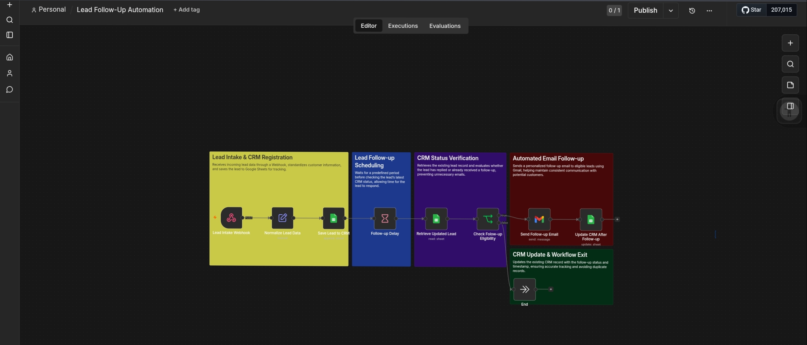

Lead Follow-Up Automation

  <strong>Automated lead follow-ups using n8n, Google Sheets, and Gmail</strong>

---

Overview

This project demonstrates a lead follow-up automation workflow built with n8n.

The workflow helps businesses manage lead statuses, send follow-up emails, and keep lead records updated in Google Sheets.

By connecting these applications, the automation reduces repetitive manual tasks and helps maintain a more organized sales process.

Workflow

  

How It Works

1. Lead Data — Retrieves lead information from Google Sheets.
2. Status Checking — Evaluates the lead's current status and follow-up information.
3. Follow-Up Email — Sends an email through Gmail when the workflow conditions are met.
4. Record Update — Updates the corresponding lead record in Google Sheets.
5. Lead Tracking — Keeps lead information organized for future follow-ups.

Key Features

- Automated lead follow-up process
- Gmail email integration
- Google Sheets data management
- Conditional workflow logic
- Automated updates to existing lead records
- Reduced repetitive administrative tasks

Technologies Used

- n8n
- Google Sheets
- Gmail
- Webhooks and integrations
- Conditional Logic
- Data Processing

Business Value

This workflow can help businesses:

- Maintain consistent communication with prospects
- Reduce manual follow-up work
- Keep lead records up to date
- Improve sales pipeline organization
- Minimize the risk of overlooking leads

Workflow Architecture

Google Sheets
      ↓
Retrieve Lead Data
      ↓
Check Conditions
      ↓
Send Follow-Up Email
      ↓
Update Lead Record
      ↓
Google Sheets

Project Status

Completed portfolio project.

This project demonstrates practical skills in workflow automation, application integration, conditional logic, and business process optimization.

---

  <i>Helping businesses stay organized and follow up with leads efficiently.</i>

